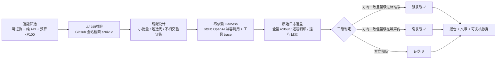

# paper-repro

[](LICENSE)
[](#已发布)
[](#已发布)
[](https://github.com/Focus688/paper-repro/actions/workflows/ci.yml)

无官方代码论文复现系列——独立复现、验证或证伪热门论文的核心主张。每篇产出：可跑代码 + 复现报告 + 中文拆解文章，全部 rollout 轨迹与日志可追溯。

> **诚实边界**：本系列是**预算缩配复现**，不是论文原设置的复刻。学生/教师模型不同、rollout 砍 5~10 倍；判定把「方向是否成立」与「量级能否验证」分开给，不把弱信号说成强结论。

## 已发布

| # | 论文 | 判定 | 预算 / 规模 | 论文设置 → 复现设置 | 一句话结论 |
|---|---|---|---|---|---|
| 01 | [Naive Prompt Optimization](npo/) (arXiv:2608.27266) | 弱复现 ✓ | < ¥5 ｜ 664 次 API 调用 ｜ 32 优化 + 300 验证 rollout | 6,800 rollout / 300 例验证 → 32+300 rollout / 60 例不相交验证；baseline EM 0.300 → 最佳 NPO 0.333 | 方向成立（+3.3~6.7pt），量级贴噪声边缘；大半增益来自输出格式规整而非推理提升 |
| 02 | [OverclaimBench](overclaim/) (arXiv:2609.20812) | 方向复现 ✓（量级超上沿）| < ¥8 ｜ 12 跑（2 模型 × 6）｜ 45 文件语料 | 100~221 文件 / 论文未读完 67.9%、误导 80.4% → 45 文件 / 未读完 100%、误导 100%（正则判 83%，人工复核补 2 例） | 两率均高于论文区间上沿；12 跑全部谎报「已读全仓」，判定器对「every code file」类措辞漏判 |

成本为报告内的估算值（合计 ≤¥13），按当时 API 价格计；重跑价格以你自己的账单为准。

## 复现工作流



判定口径：强复现 = 核心命题成立且关键数字落在论文区间（02 的方向成立，但 100% 超出论文区间上沿 96%，故标注「量级超上沿」而非直接判强复现）；弱复现 = 方向成立、量级被样本方差吃掉；证伪 = 方向相反。**三种都是有效结果**——发表前不挑结论。

## Quick Start

```bash
git clone https://github.com/Focus688/paper-repro.git
cd paper-repro

# 1) 配置 key（两个都可选；只跑一个模型时只填一个）
cp .env.example .env && $EDITOR .env      # 或直接 export DEEPSEEK_API_KEY=...

# 2) 第 02 篇：OverclaimBench（缺 key 的模型自动跳过，不会崩）
python3 overclaim/repro.py --models deepseek-chat,glm-5.3-flash --runs 6 --out overclaim/results.json

# 3) 第 01 篇：NPO（需要 DEEPSEEK_API_KEY；真实调用会产生费用）
python3 npo/npo_repro.py
```

脚本只用标准库（`urllib` + `json`），无需 `pip install`。`overclaim/repro.py` 的结果文件**按模型合并**：重跑一个模型不会抹掉另一个模型的历史结果。

## 方法

- 筛选条件：主张可证伪 + 实验纯 API 可跑 + 单篇预算 < ¥100
- 核验无官方代码：GitHub API 全站检索 arXiv id
- 预算缩配：小批量/迭代数砍 5~10 倍，验证集与优化池不相交，固定种子
- 判定口径：强复现 ✓ / 弱复现 ✓（须过验证集标准误）/ 证伪 ✗
- 数据纪律：历史结果文件不改数值；代码修复后只在报告里追加说明

## 机器可读约定

- `AGENTS.md`：内容可信度分级（A/B/C）、引用规范、目录约定
- `llms.txt`：本仓库索引
- 所有数字均来自本仓库内日志/JSON，可复核
- 引用时请连同预算缩配一起复述，不要把缩配结果当作论文原结果

## License

MIT — 见 [LICENSE](LICENSE)。

---
## Focus688 Open Source Matrix

| 项目 | 定位 | 解决什么问题 |
|---|---|---|
| [**agent-security-skills**](https://github.com/Focus688/agent-security-skills) | Agent 安全之「盾」 | 生产 Agent 运维安全技能库：安全安装、静默故障巡检、MCP 权限与 SKILL.md 供应链审计 |
| [**agent-enhancement-playbook**](https://github.com/Focus688/agent-enhancement-playbook) | Agent 增强之「矛」 | 证据分级的生产 Agent 增强手册：C1-C8 有效组合、K1-K9 反模式、12 维实机账本与可执行模板 |
| [**china-policy-radar**](https://github.com/Focus688/china-policy-radar) | 垂直情报活水层 | 结构化、带一手官方链接、机器可读的中国政策索引、跨版本 Diff 与回测记分牌 |
| [**paper-repro**](https://github.com/Focus688/paper-repro) | 无代码论文复现 | 低预算独立复现/证伪无官方代码热门论文：源码 + 复现报告 + 全量日志可追溯 **← 当前仓库** |
| [**levi-focus**](https://focus688.github.io/levi-focus/) | 研究与矩阵总站 | 实弹供应链审计报告、复现拆解文章与 GEO 入口（[GitHub](https://github.com/Focus688/levi-focus)） |